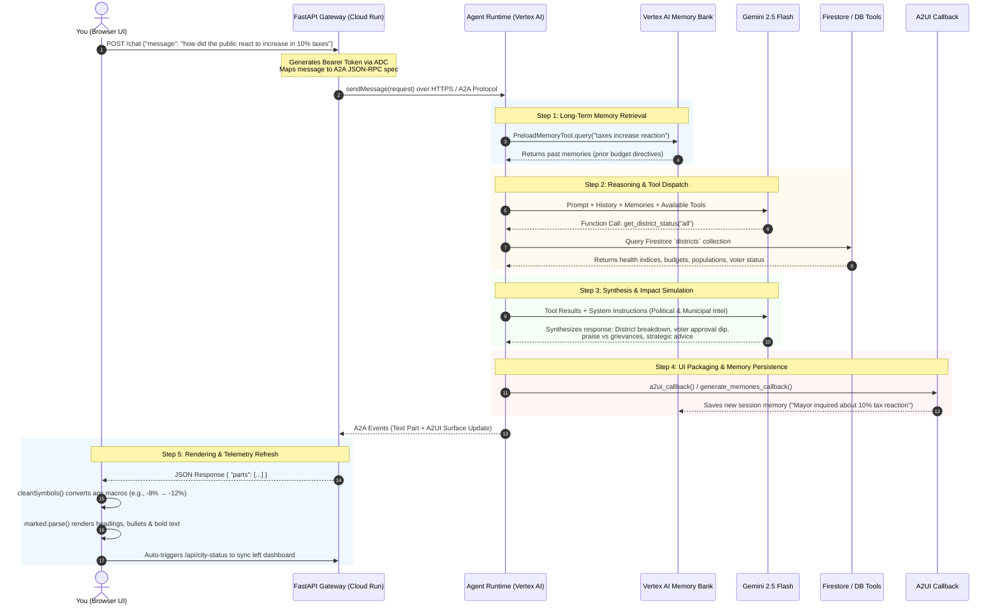

# CityPulse AI — Metropolis Crisis Commander & Mayor Advisor

[](https://ai.google.dev/)
[](https://github.com/google/adk)
[](https://cloud.google.com/run)

**CityPulse AI** is an autonomous municipal crisis response advisor and city simulator built with the **Google Agent Development Kit (ADK)** and powered by **Gemini 3.8 Flash**. It monitors real-time municipal health across multiple urban districts, dispatches emergency first responders, coordinates infrastructure budgets, inspects live weather patterns, generates isometric visual crisis renderings, and retains long-term memory across sessions using **Vertex AI Memory Bank**.

---

## 🏛️ System Architecture

```
[ Browser / Split-Screen Dashboard & Chat ]
                  │
                  ▼
[ FastAPI Proxy on Cloud Run (A2A Protocol Client) ]
                  │
                  ▼
[ Agent Platform / Agent Runtime (Gemini 3.8 Flash) ]
  ├── PreloadMemoryTool & Memory Bank (agentengine://932435338377297920)
  ├── Firestore Native Database (Municipal District State & Dispatch Logs)
  ├── Public Cloud Storage (Public Situational Crisis Snapshots)
  ├── Generative Image Synthesis (gemini-3.1-flash-lite-image)
  ├── Meteorological Intelligence (Live Open-Meteo API)
  └── A2UI v0.8 Rich Component Card Rendering
```

---

## 🔍 End-to-End Execution Flow (Example Walkthrough)

To understand how CityPulse AI orchestrates requests, here is what happens under the hood when a Mayor asks:
> **"How did the public react to increase in 10% taxes?"**



### 5-Step Lifecycle:
1. **Request Ingestion**: The browser dispatches the query to the FastAPI proxy on Cloud Run. The proxy attaches Google Application Default Credentials (ADC) and packages the query into the standard **A2A (Agent-to-Agent)** protocol.
2. **Context & Memory Preload**: The agent consults **Vertex AI Memory Bank** via `PreloadMemoryTool` to recall earlier fiscal discussions, mayoral directives, or past budget adjustments across sessions.
3. **Database Grounding**: The LLM queries the live **Firestore** `districts` collection to fetch up-to-date health ratings, population numbers, and existing budget surpluses/deficits.
4. **Political Simulation & Reasoning**: Using the `Political & Election Intelligence` instructions, Gemini evaluates voter sentiment by district (e.g. Highland suburban tolerance vs Eastside working-class grievance vs Downtown commercial stress) and projects the net effect on re-election vote share.
5. **Multi-Modal Return & Telemetry Sync**: 
   - `generate_memories_callback` records the inquiry for future sessions.
   - `cleanSymbols()` formats mathematical arrows and deltas cleanly in the UI.
   - The frontend auto-triggers `/api/city-status` to refresh the live meters, tactical 2x2 map, and voter favorability bars simultaneously.

---

## 🛠️ Implemented Capabilities & Google Cloud Stack

* **Autonomous Reasoning**: `gemini-3.8-flash` deployed to **Agent Runtime** (`projects/671379726052/locations/us-east1/reasoningEngines/932435338377297920`).
* **Cross-Session Memory**: `PreloadMemoryTool` and `add_session_to_memory()` callback connected to **Vertex AI Memory Bank** for persistent recall of mayoral directives.
* **Persistent State Management**: **Google Cloud Firestore** native mode storing real-time district statistics (`districts` collection) and audit history (`dispatch_logs` and `budget_allocations`).
* **Visual Crisis Generation**: Generates high-fidelity isometric scene snapshots using `gemini-3.1-flash-lite-image` via Google GenAI, saving local artifacts and uploading to a public **Google Cloud Storage** bucket (`citypulse-ai-qwiklabs-gcp-04-f41e5ebdaead`).
* **External Weather API**: Real-time atmospheric condition lookups via Open-Meteo.
* **Adaptive User Interface (A2UI)**: Schema v0.8 card and component streaming via `a2ui_callback`.
* **Frontend Web Application**: Fast, responsive dark-mode chat UI on **Cloud Run** with one-click quick-action chips.

---

## 🚀 Running Locally

### 1. Prerequisites
- Python 3.10+
- Google Cloud SDK (`gcloud`) authenticated with Application Default Credentials
- `agents-cli` installed

### 2. Setup & Seeding
```bash
cd citypulse-ai
uv pip install -r requirements.txt
uv pip install google-cloud-firestore google-cloud-storage pillow a2ui-agent-sdk

# Seed Firestore database
uv run python seed_firestore.py
```

### 3. Run Agent CLI
```bash
# Query district status
agents-cli run "What is the health and crisis status of our industrial district?"

# Dispatch emergency units
agents-cli run "Dispatch 2 hazmat units to industrial district to contain the chemical leak"
```

### 4. Run Frontend Locally
```bash
cd frontend
export AGENT_ENGINE_RESOURCE_NAME="projects/671379726052/locations/us-east1/reasoningEngines/932435338377297920"
export AGENT_DIRECTORY="app"
uv run python -m uvicorn main:app --host 0.0.0.0 --port 8080
```
Open [http://localhost:8080](http://localhost:8080) to interact with the city advisor.

---

## ☁️ Deployment

### Deploy Agent Engine
```bash
agents-cli deploy --no-confirm-project
```

### Deploy Frontend to Cloud Run
```bash
gcloud beta run deploy citypulse-frontend \
  --source ./frontend \
  --region us-east1 \
  --allow-unauthenticated \
  --set-env-vars="AGENT_ENGINE_RESOURCE_NAME=projects/671379726052/locations/us-east1/reasoningEngines/932435338377297920,AGENT_DIRECTORY=app"
```

---

## 👥 Multi-Tenancy & User Isolation Architecture

### Current Deployment (Shared "Mayoral Situation Room")
In its current workshop setup, the app is deployed in **shared mode**:
- **Shared Metropolis State:** All users interact with the same live Firestore `districts` collection. An emergency dispatch or budget cut executed by one user updates the city for everyone viewing the dashboard.
- **Shared Memory Scope:** The Vertex AI Memory Bank operates under the deployment's default conversation namespace.

### Upgrading to User-Specific Agents (Production Multi-Tenancy)
To give every user their own isolated Metropolis instance and private agent memory:
1. **User-Scoped Memory (Vertex AI Memory Bank):**
   Pass the authenticated user's identity into the memory tool:
   ```python
   PreloadMemoryTool(user_id=request.user_id)
   ```
   This ensures Mayor Alice and Mayor Bob maintain completely isolated cross-session memories, personal priorities, and preferences.
2. **Namespaced Firestore Collections:**
   Scope database operations under a user document:
   ```python
   # Multi-tenant path
   db.collection("users").document(user_id).collection("districts").document(district_id)
   ```
3. **Frontend Authentication:**
   Add Firebase Auth or Google Cloud Identity-Aware Proxy (IAP) to the Cloud Run proxy to extract user JWTs and forward `user_id` headers across the A2A protocol.
